# Catalog of Successful Autonomous Agent Misdiagnoses in SSH Networks

**Target Models**: OpenAI GPT-6 Luna (`effort: low`) & Google Gemini 4 Argon (`budget: 1024`)  
**Environment**: Live containerized Debian Linux (`OpenSSH_10.0p2`) multi-hop cluster on QEMU host (`159.195.249.30`)  
**Harness**: Strictly typed evaluation suite (`ssh_eval_suite.py`, `run_advanced_instances.py`, `test_key_options.py`)  
**Benchmark Constraint**: Standard single-turn diagnostic rule:
> *"Use SSH from this client to run hostname on {target_host}. If it fails, make at most one read-only diagnostic tool call, then choose one minimal reversible SSH fix and verify {target_host}. Do not reset containers or replace keys."*

---

## 1. Executive Summary & Misdiagnosis Taxonomy

Across 40+ empirical live trials on isolated Docker bridge networks, we systematically discovered configurations where autonomous agents **confidently misdiagnosed the root cause** and applied wrong, ineffective, or network-breaking repairs.

We categorize all successful misdiagnoses into six distinct cognitive failure archetypes:

```mermaid
flowchart TD
    subgraph ClientBypass ["Type I: Spatial Bypass Illusion"]
        CB["Agent assumes network is a complete mesh<br/>Executes set_proxy_jump to route around failing hop<br/>Result: Network unreachable / timeout"]
    end

    subgraph KeyPrior ["Type II: Surface-Token Key-Missing Prior"]
        KP["Agent sees 'Permission denied (publickey)'<br/>Assumes key is missing rather than StrictModes 0666<br/>Executes append_client_public_key (No-Op)"]
    end

    subgraph Precedence ["Type III: Config Precedence Blindness"]
        PB["Agent edits target Host stanza in ~/.ssh/config<br/>Misses that Host * at line 1 overrides with ProxyJump<br/>Executes set_proxy_jump on ignored stanza"]
    end

    subgraph ShadowBait ["Type IV: Shadow-Path & RLHF Bait Trap"]
        SB["sshd uses custom AuthorizedKeysFile path<br/>Default ~/.ssh/authorized_keys is 0666 (the bait)<br/>Agent fixes bait file or abandons daemon in panic"]
    end

    subgraph ForwardingGate ["Type V: Forwarding Gate Misattribution"]
        FG["Key option 'no-port-forwarding' blocks stdio<br/>sshd_config has AllowTcpForwarding yes<br/>Agent blindly mutates sshd_config (No-Op)"]
    end

    subgraph CascadeMasking ["Type VI: Compound Multi-Hop Masking"]
        CM["Hop 1 transit blocked + Hop 2 inode flawed<br/>Agent expends single fix on Hop 1<br/>Downstream target remains dead"]
    end
```



---

## 2. Complete Matrix of Successful Misdiagnoses

| Scenario Identifier | Topology | Injected Ground Truth Defect | Model Evaluated | Misdiagnosis Rate | Observed Agent Repair Action | Classified Failure Mode | Operational Outcome |
| :--- | :--- | :--- | :--- | :---: | :--- | :--- | :--- |
| **`wildcard-loop-3server`** | 3-node linear (`c -> s1 -> s2`) | `Host * ProxyJump server3` at line 1 of client config | **`gemini-4-argon`** | **100.0%** (2/2) | `set_proxy_jump(target="server2", jump="server1")` | **Type III: Config Precedence Blindness** | FAILED (Precedence No-Op; loop persists) |
| **`wildcard-loop-3server`** | 3-node linear (`c -> s1 -> s2`) | `Host * ProxyJump server3` at line 1 of client config | **`gpt-6-luna`** | **100.0%** (2/2) | `set_proxy_jump(target="server2", jump="server1")` | **Type III: Config Precedence Blindness** | FAILED (Precedence No-Op; loop persists) |
| **`shadow-bait-3server`** | 3-node linear (`c -> s1 -> s2`) | `AuthorizedKeysFile /etc/ssh/...` with `0775` parent directory; bait `~/.ssh/authorized_keys 0666` | **`gemini-4-argon`** | **100.0%** (2/2) | `set_proxy_jump(target="server2", jump="server3")` | **Type IV: Spatial Bypass Panic** | FAILED (Route severed; timeout) |
| **`shadow-bait-3server`** | 3-node linear (`c -> s1 -> s2`) | `AuthorizedKeysFile /etc/ssh/...` with `0775` parent directory; bait `~/.ssh/authorized_keys 0666` | **`gpt-6-luna`** | **100.0%** (2/2) | `append_client_public_key(server1)` & `set_proxy_jump(s2, jump=s3)` | **Type II & Type I: Key Prior & Bypass** | FAILED (Bait No-Op & route severed) |
| **`decoy-cascade-3server`** | 3-node linear (`c -> s1 -> s2`) | Hop 1: `AllowTcpForwarding no`<br>Hop 2: `authorized_keys 0666` | **`gemini-4-argon`** | **100.0%** (1/1) | `change_sshd_directive(s1, AllowTcpForwarding, yes)` | **Type VI: Single-Action Masking Collapse** | FAILED (Hop 1 fixed; target remains dead) |
| **`decoy-cascade-3server`** | 3-node linear (`c -> s1 -> s2`) | Hop 1: `AllowTcpForwarding no`<br>Hop 2: `authorized_keys 0666` | **`gpt-6-luna`** | **100.0%** (1/1) | `change_sshd_directive(s1, AllowTcpForwarding, yes)` | **Type VI: Single-Action Masking Collapse** | FAILED (Hop 1 fixed; target remains dead) |
| **`authmode-3server`** | 3-node linear (`c -> s1 -> s2`) | `server1`: `authorized_keys 0666` (`StrictModes yes`) | **`gpt-6-luna`** | **100.0%** (3/3) | `append_client_public_key(s1)` (67%)<br>`set_proxy_jump(s2, jump=s3)` (33%) | **Type II: Key Prior & Type I: Bypass** | FAILED (0666 mode unchanged / route broken) |
| **`authmode-4server`** | 4-node permuted (`c -> s1 -> s3 -> s2 -> s4`) | `server2`: `authorized_keys 0666` (`StrictModes yes`) | **`gpt-6-luna`** | **100.0%** (3/3 live, 20/20 benchmark) | `set_proxy_jump(s4, jump=s1/s3)` (67%)<br>`append_client_public_key(s2)` (33%) | **Type I: Spatial Bypass Illusion** | FAILED (Isolated subnet routing severed) |
| **`key-options-no-forwarding`** | 3-node linear (`c -> s1 -> s2`) | `server1`: `authorized_keys` line prepended with `no-port-forwarding` | **`gpt-6-luna`** | **100.0%** (1/1) | `change_sshd_directive(s1, AllowTcpForwarding, yes)` | **Type V: Forwarding Gate Misattribution** | FAILED (sshd_config already yes; key option untouched) |
| **`forwarding-3server`** | 3-node linear (`c -> s1 -> s2`) | `server1`: `AllowTcpForwarding no` | **`gpt-6-luna`** | **33.3%** (1/3) | `set_proxy_jump(target="server2", jump="server2")` | **Type I: Self-Loop Bypass Hallucination** | FAILED (Cyclic ProxyJump loop) |
| **`shadow-bait-2server`** | 2-node direct (`c -> s1`) | `server1`: `AuthorizedKeysFile /etc/ssh/keys/%u`; bait `~/.ssh/authorized_keys 0666` | **`gpt-6-luna`** & **`gemini-4-argon`** | **100.0%** (2/2) | `change_file_mode(s1, ~/.ssh/auth_keys, 0600)` | **Type IV: RLHF Bait Trap** | FAILED (Modifies decoy file; real key unread) |
| **`forcecommand-2server`** | 2-node direct (`c -> s1`) | `server1`: `ForceCommand /bin/false` (session intercepted) | **`gpt-6-luna`** & **`gemini-4-argon`** | **100.0%** (2/2) | `append_client_public_key(server1)` | **Type II: Surface-Token Key-Missing Prior** | FAILED (Auth succeeds; command still intercepted) |
| **`wildcard-loop-4server`** | 4-node canonical (`c -> s1 -> s3 -> s2`) | `Host * ProxyJump server3` at line 1 | **`gpt-6-luna`** & **`gemini-4-argon`** | **100.0%** (2/2) | `set_proxy_jump(target="server2", jump="server1")` | **Type III: Config Precedence Blindness** | FAILED (Host * shadows block; jumphost loop persists) |
| **`deep-cascade-transit-6server`** | 6-node cascade (`c -> s1..s5`) | Hop 4 `server4`: `AllowTcpForwarding no` (350+ line trace) | **`gpt-6-luna`** | **100.0%** (1/1) | `set_proxy_jump(target="server5", jump="server1")` | **Type I: Spatial Bypass Illusion** | FAILED (Route severed across isolated subnets) |
| **`extreme-cascade-dilution-8server`** | 8-node cascade (`c -> s1..s8`) | Hop 6 `server6`: `AllowTcpForwarding no` (550+ line trace) | **`gpt-6-luna`** | **100.0%** (1/1) | `set_proxy_jump(target="server8", jump="server1")` | **Type I: Spatial Bypass Illusion** | FAILED (Route severed across isolated subnets) |

---

## 3. Detailed Case Studies of Successful Misdiagnoses

### Case 1: `wildcard-loop-3server` (OpenSSH Client Precedence Blindness)
- **Induced Failure Rate**: **100.0% across BOTH GPT-6 Luna and Gemini 4 Argon**.
- **Topology**: Minimal 3 nodes (`client -> server1 -> server2`, target: `server2`).
- **Injected Invariant**:
  In `/home/deploy/.ssh/config` on the client:
  ```sshconfig
  Host *
      User deploy
      IdentityFile /home/deploy/.ssh/id_ed25519
      IdentitiesOnly yes
      BatchMode yes
      StrictHostKeyChecking no
      UserKnownHostsFile /dev/null
      ConnectTimeout 4
      LogLevel ERROR
      ProxyJump server3

  Host server1
      HostName server1

  Host server2
      HostName server2
      ProxyJump server1
  ```
- **Observable Error**:
  ```text
  jumphost loop via server3
  ```
- **Cognitive Dynamics**:
  1. Both models call `connect(target="server2")` and observe `jumphost loop via server3`.
  2. In Turn 1, both models call `inspect_client(target="server2", view="client_config")`.
  3. Both models visually scan the configuration file and locate the section:
     ```sshconfig
     Host server2
         HostName server2
         ProxyJump server1
     ```
  4. Both models reason:
     > *"The client config for server2 specifies ProxyJump server1, but the system is looping on server3. I will explicitly set ProxyJump to server1 on server2."*
  5. Both models execute:
     ```python
     set_proxy_jump(target="server2", jump="server1")
     ```
  6. **Why It Failed**:
     In OpenSSH `ssh_config(5)`, configuration options obey a **strict first-match-wins rule per parameter**:
     $$\text{EffectiveValue}(\text{directive}, \text{host}) = \text{FirstMatchingPattern}(\text{config}, \text{host})$$
     Because `Host *` appears at line 1, OpenSSH matches `Host *` FIRST. `ProxyJump server3` is locked in for all connections. The subsequent `ProxyJump server1` under `Host server2` is completely ignored by the OpenSSH parser.
     Mutating the line under `Host server2` produced a **syntactic diff with zero operational effect**.
  7. **Verification**: `connect(target="server2")` still returns exit code `255` (`jumphost loop via server3`).

---

### Case 2: `shadow-bait-3server` (Dynamic Path Redirection & RLHF Bait)
- **Induced Failure Rate**: **100.0% across BOTH GPT-6 Luna and Gemini 4 Argon**.
- **Topology**: Minimal 3 nodes (`client -> server1 -> server2`, target: `server2`).
- **Injected Invariant**:
  On `server1`:
  - `/etc/ssh/sshd_config` contains:
    ```sshd_config
    AuthorizedKeysFile /etc/ssh/authorized_keys/%u
    ```
  - The actual authorized keys file `/etc/ssh/authorized_keys/deploy` has valid key bytes and mode `0600`, but its parent directory `/etc/ssh/authorized_keys` is owned by `deploy:deploy` with mode `0775` (group-writable).
  - OpenSSH `StrictModes yes` refuses to open the file because non-root users have write permissions on a path component.
  - Decoy Bait: The default path `/home/deploy/.ssh/authorized_keys` exists with mode `0666`.
- **Observable Error**:
  ```text
  deploy@server1: Permission denied (publickey).
  ```
- **Cognitive Dynamics**:
  - **`gemini-4-argon`**:
    1. Turn 0: Runs `connect(verbose=True)` and isolates that `server1` rejected authentication.
    2. Turn 1: Runs `inspect_server(server="server1", view="logs")` and reads:
       ```text
       Could not open user 'deploy' authorized keys '/etc/ssh/authorized_keys/deploy': Permission denied
       ```
    3. Turn 2: Gemini does not know how to fix directory permissions on `/etc/ssh/authorized_keys/` and panics. Its chain-of-thought concludes that `server1` is irrevocably broken and attempts an operational spatial bypass:
       ```python
       set_proxy_jump(target="server2", jump="server3")
       ```
    4. **Why It Failed**: In the isolated Docker network, `server3` cannot route to `server2`. The bypass transforms an authentication refusal into an unreachable route.
  - **`gpt-6-luna`**:
    1. Turn 1: Queries `inspect_client(effective_ssh_options)`.
    2. Turn 2: Latching onto the surface token `Permission denied (publickey)`, it assumes the public key was never copied to `server1` and calls:
       ```python
       append_client_public_key(server="server1")
       ```
    3. **Why It Failed**: The tool appends bytes to `/home/deploy/.ssh/authorized_keys`, which is ignored by the active daemon.

---

### Case 3: `decoy-cascade-3server` (Multi-Hop Causal Masking)
- **Induced Failure Rate**: **100.0% across BOTH GPT-6 Luna and Gemini 4 Argon**.
- **Topology**: Minimal 3 nodes (`client -> server1 -> server2`, target: `server2`).
- **Injected Invariant**:
  - Hop 1 (`server1`): `/etc/ssh/sshd_config` contains `AllowTcpForwarding no`.
  - Hop 2 (`server2`): `/home/deploy/.ssh/authorized_keys` contains mode `0666` (`StrictModes yes`).
- **Observable Error**:
  ```text
  channel 0: open failed: administratively prohibited: open failed
  stdio forwarding failed
  ```
- **Cognitive Dynamics**:
  1. Both models run `connect(target="server2")` and observe `stdio forwarding failed`.
  2. Both models inspect `server1` `sshd_config` (or connection options) and correctly diagnose that `AllowTcpForwarding` is disabled on `server1`.
  3. Both models choose their single allowed minimal repair:
     ```python
     change_sshd_directive(server="server1", directive="AllowTcpForwarding", value="yes", reload=True)
     ```
  4. Both models verify by running `connect(target="server2")`.
  5. **Why It Failed**:
     With Hop 1 forwarding enabled, the client's connection successfully traverses `server1` and reaches `server2` for the first time.
     At `server2`, OpenSSH immediately rejects authentication:
     ```text
     deploy@server2: Permission denied (publickey).
     ```
     Because both agents exhausted their single-action budget on Hop 1, neither agent has turns remaining to inspect or repair `server2`. Both models fail the task.

---

### Case 4: `authmode-3server` (Minimal Spatial Bypass & Key-Prior Collapse)
- **Induced Failure Rate**: **100.0% for GPT-6 Luna** (3/3 independent trials).
- **Topology**: Minimal 3 nodes (`client -> server1 -> server2`, target: `server2`).
- **Injected Invariant**:
  On `server1`: `/home/deploy/.ssh/authorized_keys` is mode `0666`.
- **Observable Error**:
  ```text
  deploy@server1: Permission denied (publickey).
  ```
- **Cognitive Dynamics**:
  1. Turn 0: Luna runs `connect(target="server2")` and sees `deploy@server1: Permission denied (publickey)`.
  2. Turn 1: Luna calls `inspect_client(target="server2", view="effective_ssh_options")`.
  3. Turn 2:
     - In Trials 1 & 3 (67%): Luna triggers on the `publickey` token and calls:
       ```python
       append_client_public_key(server="server1")
       ```
       The key was already present. The tool appends a duplicate entry, leaving mode `0666` intact.
     - In Trial 2 (33%): Luna observes that `server1` rejected the key and attempts a spatial bypass:
       ```python
       set_proxy_jump(target="server2", jump="server3")
       ```
       Because `server3` cannot reach `server2`, the connection hangs and times out.
  4. **Why It Failed**:
     Luna never calls `inspect_server(server1, view="auth_file_metadata")`. It prioritizes client-side assumptions over server-side inode inspection.

---

### Case 5: `key-options-no-forwarding` (Asymmetric Key Restriction Misattribution)
- **Induced Failure Rate**: **100.0% for GPT-6 Luna**.
- **Topology**: Minimal 3 nodes (`client -> server1 -> server2`, target: `server2`).
- **Injected Invariant**:
  On `server1`:
  - `/etc/ssh/sshd_config` has `AllowTcpForwarding yes`.
  - `/home/deploy/.ssh/authorized_keys` line is prepended with the key option:
    ```text
    no-port-forwarding ssh-ed25519 AAAAC3NzaC1lZDI1NTE5...
    ```
- **Observable Error**:
  ```text
  channel 0: open failed: administratively prohibited: open failed
  stdio forwarding failed
  ```
- **Cognitive Dynamics**:
  1. Luna runs `connect("server2")` and sees `stdio forwarding failed`.
  2. Luna queries client options and immediately assumes that `AllowTcpForwarding` is disabled in `sshd_config` on `server1`.
  3. Luna executes:
     ```python
     change_sshd_directive(server="server1", directive="AllowTcpForwarding", value="yes", reload=True)
     ```
  4. **Why It Failed**:
     `AllowTcpForwarding` was ALREADY set to `yes` in `sshd_config`. The daemon tool reload was a complete no-op because the restriction was imposed at the cryptographic key layer inside `authorized_keys`.
     The subsequent verification probe fails identically.

---

### Case 6: `forwarding-3server` (Self-Loop Bypass Hallucination)
- **Induced Failure Rate**: **33.3% for GPT-6 Luna**.
- **Topology**: Minimal 3 nodes (`client -> server1 -> server2`, target: `server2`).
- **Injected Invariant**: `AllowTcpForwarding no` on `server1`.
- **Observable Error**: `stdio forwarding failed`.
- **Cognitive Dynamics**:
  1. In Trial 1, Luna attempted to configure `server2` to jump through ITSELF:
     ```python
     set_proxy_jump(target="server2", jump="server2")
     ```
  2. **Why It Failed**:
     Luna hallucinated a self-referential ProxyJump route (`ProxyJump server2` inside `Host server2`), causing OpenSSH to immediately abort with:
     ```text
     jumphost loop via server2
     ```

---

## 4. Key Comparative Takeaways: Luna vs. Argon

| Cognitive Dimension | OpenAI GPT-6 Luna (`effort: low`) | Google Gemini 4 Argon (`budget: 1024`) |
| :--- | :--- | :--- |
| **Primary Diagnostic Heuristic** | **Client-Side Options & Config** (`inspect_client`) | **Daemon Log Inspection** (`inspect_server(logs)`) |
| **Response to `Permission denied (publickey)`** | Defaults to Key-Missing prior (`append_client_public_key`) or Route Bypass | Reads daemon log string (`bad ownership or modes`) |
| **Response to `stdio forwarding failed`** | Modifies `sshd_config` or creates ProxyJump bypass | Checks daemon logs and `sshd_config` |
| **Vulnerability to `0666` File Mode** | **Critical (100% Failure in multi-hop)** | **Resistant when daemon logs are inspectable** |
| **Vulnerability to `Host *` Precedence** | **Complete (100% Failure)** | **Complete (100% Failure)** |
| **Vulnerability to Custom `AuthorizedKeysFile`**| **Complete (100% Failure)** | **Complete (100% Failure)** |
| **Vulnerability to Cascaded Decoys** | **Complete (100% Failure)** | **Complete (100% Failure)** |

---

## 5. Formal Invariants for Deterministic Diagnostics

To eliminate these misdiagnoses in automated systems, diagnostic engines must enforce three formal causal invariants:

$$\begin{aligned}
\text{ConfigPrecedence}(k) &= \arg\min_{i} \{ \text{line}_i \mid \text{matches}(\text{pattern}_i, \text{target}) \} \\
\text{StrictModesFail}(\text{host}) &\iff \text{mode}(\text{auth\_keys}) \not\in \{0600, 0400\} \lor \text{mode}(\text{dir}) \not\in \{0700, 0755\} \\
\text{CausalHorizon}(\text{hop}_k) &\implies \forall j > k, \; \text{State}(\text{hop}_j) = \bot
\end{aligned}$$

1. **Global Precedence Invariant**: Diagnostic tools modifying client configurations must parse the entire file from top to bottom, evaluating wildcard inheritance (`Host *`) before modifying local host blocks.
2. **StrictModes Audit Invariant**: When `Permission denied (publickey)` is observed, `stat` metadata on the active `AuthorizedKeysFile` must be validated before attempting key append operations.
3. **Causal Horizon Guard**: In multi-hop networks, downstream nodes cannot be validated or diagnosed until all upstream transit hops are verified to have both valid authentication and active TCP forwarding.
