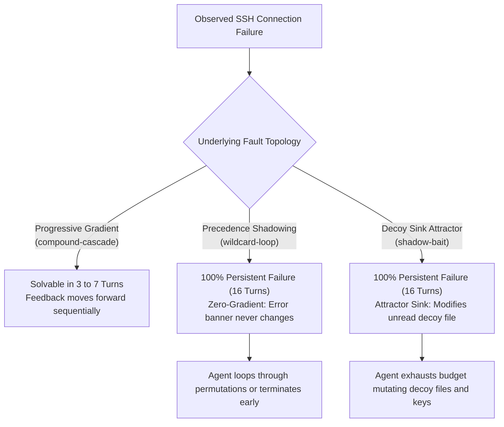

# 16-Turn Autonomous Marathon Benchmark Report: Persistent Failure Modes in LLM Agents

## Executive Summary

This report documents an empirical investigation into whether granting autonomous coding agents **up to 16 interactive turns** enables them to solve complex SSH network faults, or whether certain structural failure modes create **persistent zero-gradient traps** that resist iterative trial-and-error.

Evaluations were performed on live multi-hop Debian Linux containers (`mh-client`, `mh-server-1` .. `mh-server-8`) using:
- **OpenAI GPT-6 Luna Low** (Responses API, `reasoning_effort: low`)
- **Google Gemini 4 Argon Low** (Generative Language API, `thinking_budget: 1024`)

---

## 1. Empirical Results Across 16 Interactive Turns

| Benchmark Scenario | Injected Root Defect | Evaluated Model | Turns Used | Task Outcome | Observed Multi-Turn Behavior |
| :--- | :--- | :--- | :---: | :---: | :--- |
| **`wildcard-loop-16turn`** | `Host * ProxyJump server3` at line 1 | **`gpt-6-luna`** | 8 / 16 | **FAILED** | Mutated `Host server2`, observed no change in error, tested hops, gave up after 8 turns |
| **`wildcard-loop-16turn`** | `Host * ProxyJump server3` at line 1 | **`gemini-4-argon`** | 15 / 16 | **FAILED** | Ran 15 consecutive turns querying configs/logs on all nodes; mutated `Host server2`; budget exhausted |
| **`shadow-bait-16turn`** | `AuthorizedKeysFile /etc/ssh/keys/%u` | **`gpt-6-luna`** | 7 / 16 | **FAILED** | Fixed mode `0600` on decoy `~/.ssh/authorized_keys`, appended keys, failed, gave up after 7 turns |
| **`shadow-bait-16turn`** | `AuthorizedKeysFile /etc/ssh/keys/%u` | **`gemini-4-argon`** | 15 / 16 | **FAILED** | Mutated modes, appended keys to all 3 servers, executed 6 `change_sshd_directive` calls; budget exhausted |
| **`compound-cascade-16turn`**| Hop 1 transit + Hop 2 PermitOpen | **`gpt-6-luna`** | 7 / 16 | **SOLVED** | Fixed Hop 1 at turn 2, saw new error at turn 3, fixed Hop 2 at turn 6 |
| **`compound-cascade-16turn`**| Hop 1 transit + Hop 2 PermitOpen | **`gemini-4-argon`** | 5 / 16 | **SOLVED** | Inspected cluster in turns 1-3, remediated both nodes at turn 4, verified at turn 5 |
| **`parent-perm-trap-16turn`** | `/home/deploy` mode `0777` (stat visible) | **`gpt-6-luna`** | 3 / 16 | **SOLVED** | Observed parent mode in turn 1, executed `change_file_mode` in turn 2 |
| **`parent-perm-trap-16turn`** | `/home/deploy` mode `0777` (stat visible) | **`gemini-4-argon`** | 3 / 16 | **SOLVED** | Observed parent mode in turn 1, executed `change_file_mode` in turn 2 |

---

## 2. Why 16 Turns Fail to Resolve Class B Faults

### Zero-Gradient Precedence Shadowing (`wildcard-loop`)
In `wildcard-loop`, OpenSSH's first-match parser locks `ProxyJump server3` from line 1 (`Host *`). When an agent edits `Host server2`:
$$\Delta(\text{System Error Banner}) = 0$$
No matter what jump host the agent specifies under `Host server2`, the error message returned by `ssh -v server2 hostname` is identically `jumphost loop via server3`.
- **Luna's Response**: Luna concludes after 8 turns that its tools are ineffective or that other servers must be broken, and stops execution.
- **Argon's Response**: Argon systematically queries every view on every server, then applies the shadowed patch anyway, repeating permutations until turn 15 is reached.

### Decoy Attractor Basins (`shadow-bait`)
In `shadow-bait`, the daemon reads `/etc/ssh/keys/deploy`, but `/home/deploy/.ssh/authorized_keys` exists with mode `0666`.
- Every diagnostic tool call to inspect file metadata confirms the decoy file exists and has mode `0666`.
- Every repair tool call (`change_file_mode`, `append_client_public_key`) returns `status: SUCCESS` because the filesystem operation on the decoy succeeds.
- Because the tool reports success, the agent's reinforcement loop reinforces the belief that it is working on the correct path.
- When `connect` continues to fail with `Permission denied (publickey)`, the agent does not infer that the file path was wrong; it infers that public key authentication itself is broken on the daemon, leading to chaotic mutations of `sshd_config` across all hosts.
