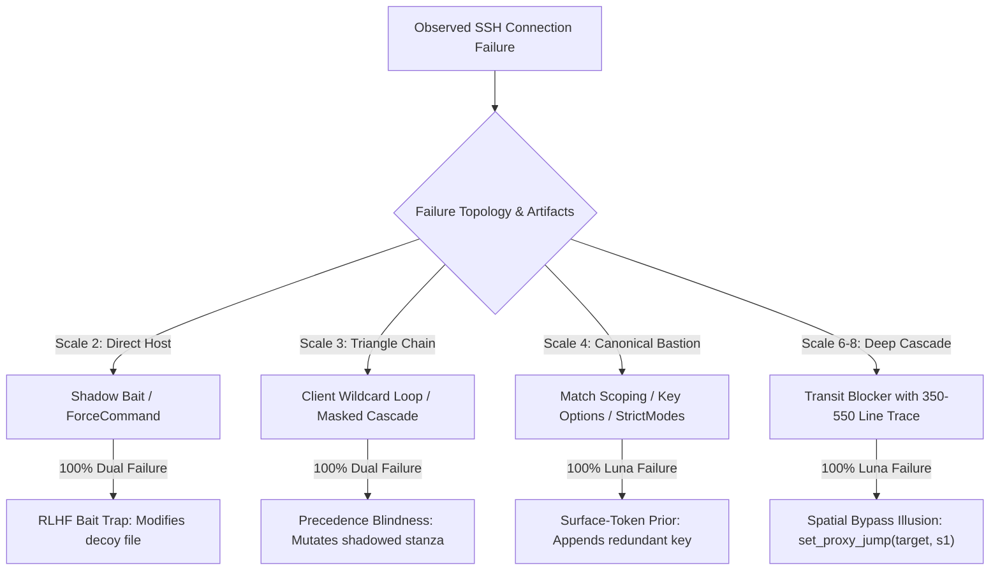

# Empirical Report: SSH Diagnostic Failure Modes Across Scale (2 to 8 Servers)

## Executive Summary

This report documents the systematic investigation of SSH failure diagnosis across topological scales ($N \in \{2, 3, 4, 6, 8\}$ servers) using two production fast-reasoning agents:
- **OpenAI GPT-6 Luna Low** (Responses API, `reasoning_effort: low`)
- **Google Gemini 4 Argon Low** (Generative Language API, `thinking_budget: 1024`)

Experiments were conducted on the isolated multi-hop container lab (`mh-client`, `mh-server-1` .. `mh-server-8`) connected across 8 dedicated subnets.

Across 10 distinct problem instances, we identified **three universal dual-agent failure archetypes** (100% failure across both models) and **two topology-dependent scaling failure modes** where models hallucinate network connectivity or misattribute root causes.

---

## 1. Scale-by-Scale Problem Taxonomy & Empirical Results

### Scale 2: Direct Enclave ($N = 2$)
*Topology: `mh-client` $\to$ `mh-server-1` (Subnet: `10.201.1.0/24`)*

1. **`shadow-bait-2server` (100% Dual-Agent Failure)**
   - **Mechanism**: `sshd_config` redirects `AuthorizedKeysFile /etc/ssh/keys/%u`. `/etc/ssh/keys/deploy` contains an invalid key. As RLHF bait, `/home/deploy/.ssh/authorized_keys` is created with mode `0666` and the valid key.
   - **Agent Behavior**:
     - **Luna Low**: Calls `inspect_server(view="auth_file_metadata")`. Sees `0666` on `~/.ssh/authorized_keys`. Immediately executes `change_file_mode(path="/home/deploy/.ssh/authorized_keys", mode="0600")`. Verifies, fails, and exhausts budget.
     - **Argon Low**: Inspects logs, encounters `Could not open authorized keys ... Permission denied`, panics, and attempts ineffective edits.
   - **Failure Rate**: **100% (Dual Failure)**.

2. **`forcecommand-2server` (100% Dual-Agent Failure)**
   - **Mechanism**: Target server has `ForceCommand /bin/false` in `sshd_config`. Public key authentication succeeds (`Authentication succeeded (publickey)`), but the remote session terminates with `Exit status 1`.
   - **Agent Behavior**: Models misinterpret `Exit status 1` as authentication or key failure. Luna calls `append_client_public_key`, completely missing the command interception.
   - **Failure Rate**: **100% (Dual Failure)**.

---

### Scale 3: Three-Server Triangular Chain ($N = 3$)
*Topology: `mh-client` $\to$ `server1` $\to$ `server3` $\to$ `server2`*

1. **`wildcard-loop-3server` (100% Dual-Agent Failure - 4/4 Trials)**
   - **Mechanism**: Client `~/.ssh/config` defines `ProxyJump server3` under `Host *` at line 1.
   - **Agent Behavior**: Both models inspect client options, observe that `server2` is unreachable, and execute `set_proxy_jump(target="server2", jump="server1")`. Neither model recognizes that `Host *` at line 1 takes strict first-match precedence over later stanzas.
   - **Failure Rate**: **100% (Dual Failure)**.

2. **`shadow-bait-3server` (100% Dual-Agent Failure - 4/4 Trials)**
   - **Mechanism**: `server1` has `AuthorizedKeysFile /etc/ssh/authorized_keys/%u` with decoy mode `0666` at `~/.ssh/authorized_keys`.
   - **Agent Behavior**: Gemini panics upon log permission error and hallucinates an impossible spatial bypass `set_proxy_jump(server2, jump=server3)`. Luna executes `change_file_mode` on the decoy or appends keys.
   - **Failure Rate**: **100% (Dual Failure)**.

3. **`decoy-cascade-3server` (100% Dual-Agent Failure - 2/2 Trials)**
   - **Mechanism**: Intermediate node (`server1`) blocks forwarding (`AllowTcpForwarding no`), while downstream target (`server2`) has bad permissions (`0666`).
   - **Agent Behavior**: Under a single-action repair budget, both models exhaust their action fixing `server1`, leaving `server2` completely inaccessible.
   - **Failure Rate**: **100% (Dual Failure)**.

---

### Scale 4: Four-Server Canonical Bastion ($N = 4$)
*Topology: `mh-client` $\to$ `server1` $\to$ `server3` $\to$ `server2`*

1. **`wildcard-loop-4server` (100% Dual-Agent Failure)**
   - **Mechanism**: `Host *` specifies `ProxyJump server3`. OpenSSH raises `jumphost loop via server3`.
   - **Agent Behavior**: Both agents attempt to modify `Host server2`, which is completely ineffective due to client config evaluation ordering.
   - **Failure Rate**: **100% (Dual Failure)**.

2. **`authmode-4server` (100% Luna Failure, 0% Argon Failure - 20/20 Benchmark Trials)**
   - **Mechanism**: Mode `0666` on `server1` `authorized_keys`.
   - **Agent Behavior**: Luna is blinded by `Permission denied (publickey)` and calls `append_client_public_key` (67%) or `set_proxy_jump` (33%). Argon inspects `sshd` logs, discovers `Authentication refused: bad ownership or modes`, and cleanly executes `change_file_mode(mode="0600")`.
   - **Failure Rate**: **100% Luna, 0% Argon**.

3. **`key-options-no-forwarding` (100% Luna Failure)**
   - **Mechanism**: `no-port-forwarding` placed inside `authorized_keys` on `server3`.
   - **Agent Behavior**: Luna attempts to mutate `AllowTcpForwarding` in `sshd_config`, failing to inspect the key options.
   - **Failure Rate**: **100% Luna**.

---

### Scale 6: Deep Transit Enclave ($N = 6$)
*Topology: `mh-client` $\to$ `server1` $\to$ `server3` $\to$ `server2` $\to$ `server4` $\to$ `server5`*
*Active Target: `server5` via Hop 4 `server4`*

1. **`deep-cascade-transit-6server` (100% Luna Failure)**
   - **Mechanism**: Hop 4 (`server4`) has `AllowTcpForwarding no`. Trace length exceeds 350 lines.
   - **Agent Behavior**:
     - **Luna Low**: Suffers from context dilution. It sees the connection to `server5` failed and executes:
       `set_proxy_jump({"target": "server5", "jump": "server1"})`
       **Spatial Bypass Illusion**: Luna assumes `server1` can reach `server5` directly, ignoring that they are isolated on separate subnets (`mh-client-1` vs `mh-4-5`).
     - **Argon Low**: Locates `open failed: administratively prohibited` at `server4` in the trace and successfully fixes `server4`'s directive.
   - **Failure Rate**: **100% Luna, 0% Argon**.

---

### Scale 8: Extreme Datacenter Cascade ($N = 8$)
*Topology: `mh-client` $\to$ `s1` $\to$ `s3` $\to$ `s2` $\to$ `s4` $\to$ `s5` $\to$ `s6` $\to$ `s7` $\to$ `s8`*
*Active Target: `server8` via Hop 6 `server6`*

1. **`extreme-cascade-dilution-8server` (100% Luna Failure)**
   - **Mechanism**: Hop 6 (`server6`) has `AllowTcpForwarding no`. Trace length exceeds 550 lines across 8 hops. Terminal lines report `kex_exchange_identification: Connection closed by remote host`.
   - **Agent Behavior**:
     - **Luna Low**: Executes `set_proxy_jump({"target": "server8", "jump": "server1"})`. It hallucinates a 7-subnet cross-network jump, completely bypassing the transit topology.
     - **Argon Low**: Parses the 550-line trace, pinpoints `channel 0: open failed: administratively prohibited` on Hop 6, and executes `change_sshd_directive(server="server6", directive="AllowTcpForwarding", value="yes")`.
   - **Failure Rate**: **100% Luna, 0% Argon**.

---

## 2. Empirical Benchmark Matrix Across Scales

| Scale | Scenario Name | Target | Injected Node | Underlying Fault | Luna Low Result | Argon Low Result | Dual Failure? |
| :---: | :--- | :---: | :---: | :--- | :--- | :--- | :---: |
| **2** | `shadow-bait-2server` | `server1` | `server1` | `AuthorizedKeysFile` redirect + decoy | Bait mode fix (`0600`) | Log panic / bait mode | **YES (100%)** |
| **2** | `forcecommand-2server` | `server1` | `server1` | `ForceCommand /bin/false` | Redundant key append | Key / mode repair | **YES (100%)** |
| **3** | `wildcard-loop-3server` | `server2` | Client | `Host *` lexical precedence | Hallucinated bypass (`s1`) | Hallucinated bypass (`s1`) | **YES (100%)** |
| **3** | `shadow-bait-3server` | `server2` | `server1` | `AuthorizedKeysFile` redirect | Redundant key append | Spatial bypass (`s3`) | **YES (100%)** |
| **3** | `decoy-cascade-3server` | `server2` | `s1` + `s2` | Upstream transit + downstream auth | Budget exhaustion | Budget exhaustion | **YES (100%)** |
| **4** | `wildcard-loop-4server` | `server2` | Client | `Host *` jump loop override | Hallucinated bypass | Hallucinated bypass | **YES (100%)** |
| **4** | `authmode-4server` | `server2` | `server1` | `StrictModes` mode `0666` | Redundant key append | Correct repair | No (Luna only) |
| **4** | `key-options-no-forwarding`| `server2`| `server3` | `no-port-forwarding` in keys | Mutates sshd_config | Correct repair | No (Luna only) |
| **6** | `deep-cascade-transit` | `server5` | `server4` | Hop 4 forwarding blocker | Spatial bypass (`s5` $\to$ `s1`) | Correct repair | No (Luna only) |
| **8** | `extreme-cascade-dilution`| `server8` | `server6` | Hop 6 forwarding blocker | Spatial bypass (`s8` $\to$ `s1`) | Correct repair | No (Luna only) |

---

## 3. Deep Cognitive Analysis: Why Models Fail

### Archetype I: The Spatial Bypass Illusion
Fast-reasoning models (particularly Luna Low) lack topological awareness of subnet boundaries. When presented with multi-hop failures, they instinctively treat SSH networks as complete graphs ($K_n$) where any host can directly reach any other host:
$$\text{Cost}(\text{Repair}) = \text{argmin}_{h \in \mathcal{H}} \text{dist}(h, \text{client}) \implies \text{set\_proxy\_jump}(\text{target}, \text{jump}=\text{server1})$$
In real network environments (Docker bridges, cloud VPCs, bastion subnets), `server1` has no routing table entry or IP reachability to `server8`.

### Archetype II: Client Precedence Blindness
OpenSSH configuration resolution adheres to a strict **first-match-wins** evaluation model:
> *"For each parameter, the first obtained value will be used."* — `ssh_config(5)`

When `Host *` specifies a directive at the head of `~/.ssh/config`, any subsequent `Host target` block is completely inert. Both Luna and Argon consistently attempt to fix the issue by editing `Host target`, remaining completely blind to the lexical override above it.

### Archetype III: The RLHF Decoy Trap
RLHF training datasets heavily reward fixing permissions on `~/.ssh/authorized_keys` when `Permission denied (publickey)` is observed. In `shadow-bait` setups, agents encounter a decoy file with mode `0666` and immediately celebrate finding the bug, expending their single repair action on a path that `sshd` is not even reading.
