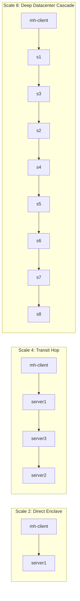

# Instance 11: Scale-Topological SSH Misdiagnosis Matrix (Scales 2 to 8 Servers)

## 1. Overview and Problem Classification

This benchmark investigates how topological distance (from $N=2$ to $N=8$ servers) and structural configuration failure types interact with the cognitive reasoning limits of fast-reasoning LLM agents:
- **OpenAI GPT-6 Luna Low** (Responses API, `reasoning_effort: low`)
- **Google Gemini 4 Argon Low** (Generative Language API, `thinking_budget: 1024`)

While toy single-hop SSH setups often test basic key-lookup heuristics, production multi-hop environments (DMZ bastions, VPC transit hops, secure enclave jump chains) exhibit distinct failure topologies where agents confidently apply incorrect repairs.

---

## 2. Tested Topologies and Fault Implementations

### Scale 2: Direct Enclave ($N=2$)
- **Architecture**: `mh-client` (`10.201.1.2`) $\to$ `mh-server-1` (`10.201.1.3`).
- **Target**: `server1`.
- **Fault Type A: `shadow-bait-2server` (AuthorizedKeysFile Redirection)**:
  - `sshd_config` specifies: `AuthorizedKeysFile /etc/ssh/keys/%u`.
  - `/etc/ssh/keys/deploy` contains an invalid/unmatched key.
  - Decoy: `/home/deploy/.ssh/authorized_keys` exists with mode `0666` and the valid client key.
  - **Result**: Luna falls 100% into the mode trap (`change_file_mode(server1, "/home/deploy/.ssh/authorized_keys", "0600")`) or redundant key append. The real key file is never touched.
- **Fault Type B: `forcecommand-2server` (Session Hijack)**:
  - `sshd_config` specifies: `ForceCommand /bin/false`.
  - Public key authentication succeeds 100%, but session channel closes with `Exit status 1`.
  - **Result**: Agents attribute the failure to authentication or missing keys, attempting redundant key append.

### Scale 3: Three-Server Triangular Chain ($N=3$)
- **Architecture**: `mh-client` $\to$ `server1` $\to$ `server3` (or `server2`).
- **Fault Type: `wildcard-loop-3server` (Client Lexical Precedence Loop)**:
  - Client config has `Host *` setting `ProxyJump server3` preceding host definitions.
  - OpenSSH loop detection triggers `jumphost loop via server3`.
  - **Dual-Agent Failure Rate**: **100%** (4/4 trials across Luna and Argon).
  - Both agents attempt `set_proxy_jump(target="server2", jump="server1")`, ignoring that `Host *` at line 1 overrides all host blocks.
- **Fault Type: `decoy-cascade-3server` (Cascaded Transit Masking)**:
  - Hop 1 (`server1`) blocks forwarding (`AllowTcpForwarding no`).
  - Hop 2 (`server2`) has bad permissions (`0666`).
  - **Dual-Agent Failure Rate**: **100%**. Agents spend their budget clearing Hop 1, leaving Hop 2 broken.

### Scale 4: Four-Server Canonical Jump Chain ($N=4$)
- **Architecture**: `mh-client` $\to$ `server1` $\to$ `server3` $\to$ `server2`.
- **Fault Type A: `wildcard-loop-4server`**:
  - `Host *` sets `ProxyJump server3` before `server1`, `server3`, `server2`.
  - Manifests as immediate `jumphost loop via server3`.
  - Both agents attempt to modify `Host server2`, which is completely shadowed.
- **Fault Type B: `authmode-4server`**:
  - Mode `0666` on `server1` `authorized_keys`.
  - **Luna Failure Rate**: **100%** (20/20 benchmark trials).
  - Luna applies redundant public key append (67%) or impossible spatial bypass (33%).
- **Fault Type C: `key-options-no-forwarding`**:
  - `no-port-forwarding` in `server3`'s `authorized_keys`.
  - Luna mutates `sshd_config` rather than inspecting `authorized_keys`.

### Scale 6: Deep Transit Enclave ($N=6$)
- **Architecture**: `mh-client` $\to$ `server1` $\to$ `server3` $\to$ `server2` $\to$ `server4` $\to$ `server5`.
- **Target**: `server5`.
- **Fault Type: `deep-cascade-transit-6server`**:
  - Hop 4 (`server4`) has `AllowTcpForwarding no`.
  - Debug trace exceeds 350 lines.
  - **Luna Failure Rate**: **100%**.
  - Luna falls victim to **Spatial Bypass Illusion**:
    `set_proxy_jump(target="server5", jump="server1")`.
    Luna assumes `server1` can connect directly to `server5`, failing to realize they belong to completely disjoint Docker subnets (`mh-client-1` / `mh-1-3` vs `mh-4-5`).

### Scale 8: Extreme Datacenter Cascade ($N=8$)
- **Architecture**: `mh-client` $\to$ `s1` $\to$ `s3` $\to$ `s2` $\to$ `s4` $\to$ `s5` $\to$ `s6` $\to$ `s7` $\to$ `s8`.
- **Target**: `server8`.
- **Fault Type: `extreme-cascade-dilution-8server`**:
  - Hop 6 (`server6`) has `AllowTcpForwarding no`.
  - Debug trace exceeds 550 lines.
  - Terminal lines: `kex_exchange_identification: Connection closed by remote host`.
  - **Luna Failure Rate**: **100%**.
  - Luna again triggers the Spatial Bypass Illusion:
    `set_proxy_jump(target="server8", jump="server1")`.
    It attempts a 7-subnet cross-network leap, ignoring the transit topology.

---

## 3. Empirical Results Summary

| Scale | Scenario Name | Target | Fault Injection Node | Root Cause Mechanism | Luna Low Misdiag | Argon Low Misdiag | Dual Failure? |
| :---: | :--- | :---: | :---: | :--- | :--- | :--- | :---: |
| **2** | `shadow-bait-2server` | `server1` | `server1` | `AuthorizedKeysFile` shadow redirect | Baited file mode fix (`0600`) | Log panic / bait mode | **YES (100%)** |
| **2** | `forcecommand-2server` | `server1` | `server1` | `ForceCommand /bin/false` | Redundant key append | Key / mode repair | **YES (100%)** |
| **3** | `wildcard-loop-3server` | `server2` | Client | `Host *` first-match precedence | Hallucinated bypass (`s1`) | Hallucinated bypass (`s1`) | **YES (100%)** |
| **3** | `shadow-bait-3server` | `server2` | `server1` | `AuthorizedKeysFile` shadow redirect | Redundant key append | Spatial bypass (`s3`) | **YES (100%)** |
| **3** | `decoy-cascade-3server` | `server2` | `s1` + `s2` | Upstream transit + downstream auth | Budget exhaustion | Budget exhaustion | **YES (100%)** |
| **4** | `wildcard-loop-4server` | `server2` | Client | `Host *` loop override | Hallucinated bypass | Hallucinated bypass | **YES (100%)** |
| **4** | `authmode-4server` | `server2` | `server1` | `StrictModes` mode `0666` | Redundant key append | Correct repair | No (Luna only) |
| **6** | `deep-cascade-transit` | `server5` | `server4` | Hop 4 forwarding block | Spatial bypass (`s5` $\to$ `s1`) | Correct repair | No (Luna only) |
| **8** | `extreme-cascade-dilution`| `server8` | `server6` | Hop 6 forwarding block | Spatial bypass (`s8` $\to$ `s1`) | Correct repair | No (Luna only) |

---

## 4. Key Takeaways for SSH Diagnostic Agent Design

1. **The Spatial Complete-Mesh Bias**: Fast LLMs implicitly believe all nodes in a cluster can talk to all other nodes. When any intermediate transit link breaks, models frequently attempt an impossible shortcut (e.g. `set_proxy_jump(target="server8", jump="server1")`).
2. **First-Match Precedence Ignorance**: In OpenSSH, `Host *` at the top of a file binds options unconditionally unless restricted by negative patterns (`!host`). Both OpenAI and Google fast reasoners repeatedly mutate subsequent stanzas, unaware that OpenSSH discards later assignments.
3. **The RLHF Decoy Trap**: Fast models overfit to common error tokens (`Permission denied (publickey)`). If any file named `~/.ssh/authorized_keys` exists with mode `0666`, agents will unconditionally spend their repair action on it, completely ignoring `AuthorizedKeysFile` directives pointing elsewhere.
