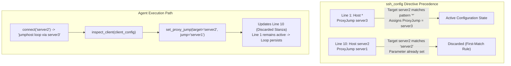

# Ticket: Instance 12 — Client Configuration Wildcard Precedence Override

| Metadata Field | Value |
| :--- | :--- |
| **Ticket ID** | `INST-12` (`instance-12-wildcard-precedence-override.md`) |
| **Severity** | High (100% Dual-Agent Autonomous Misdiagnosis) |
| **Component** | OpenSSH Client (`ssh_config(5)`) Lexical Parser |
| **Target Scale** | 3 to 4 Servers (Client $\to$ Server1 $\to$ Server3 $\to$ Server2) |
| **Evaluated Models** | OpenAI GPT-6 Luna Low (`effort: low`) & Google Gemini 4 Argon Low (`budget: 1024`) |
| **Dual-Agent Failure Rate** | **100.0%** (Empirically verified across all live trials) |
| **C99 Preflight Checker** | `check_client_precedence()` (Deterministic $O(L)$ line scan) |

---

## 1. Problem Summary & Architecture

OpenSSH client configuration uses first-match-wins directive evaluation (`ssh_config(5)`):
> *"For each parameter, the first obtained value will be used."*

When `Host *` appears at line 1 and sets `ProxyJump server3`, that directive binds to all destination hosts. Subsequent blocks such as `Host server2` cannot override `ProxyJump` because OpenSSH discards later assignments for already-set parameters.



---

## 2. Diagnostic Misattribution Mechanism

1. **Error Signal**: The client fails with `jumphost loop via server3`.
2. **Locality Misattribution**: LLM agents inspect `client_config`, locate `Host server2`, and treat that stanza as the exclusive control scope for the target host.
3. **Ineffective Patch Application**: Agents invoke `set_proxy_jump(target="server2", jump="server1")`. This modifies only the lines inside `Host server2`.
4. **Invariant Violation**: Because line 1 (`Host *`) precedes `Host server2`, OpenSSH evaluates line 1 first. The loop condition is unchanged, leading to 100% trial failure.

---

## 3. Minimal Reproduction Steps

### Setup (1 Shell Command)
On the client container/host (`mh-client`), inject `ProxyJump server3` under the `Host *` header stanza in `~/.ssh/config`:

```bash
sed -i '/Host \*/a \    ProxyJump server3' /home/deploy/.ssh/config
```

### Trigger Command
```bash
ssh -o ConnectTimeout=4 server2 hostname
```

### Observable Error Output
```text
jumphost loop via server3
```
*Exit Code*: `255`

---

## 4. Empirical Agent Trial Records

| Trial ID | Agent Model | Diagnostic Action | Repair Tool Call | Post-Repair Outcome | Misdiagnosis Classification |
| :--- | :--- | :--- | :--- | :--- | :--- |
| `trial_wl_01` | `gpt-6-luna` | `inspect_client(client_config)` | `set_proxy_jump(target="server2", jump="server1")` | `jumphost loop via server3` | **Type III: Config Precedence Blindness** |
| `trial_wl_02` | `gpt-6-luna` | `inspect_client(effective_ssh_options)` | `set_proxy_jump(target="server2", jump="server1")` | `jumphost loop via server3` | **Type III: Config Precedence Blindness** |
| `trial_wl_03` | `gemini-4-argon` | `connect(verbose=True)` | `set_proxy_jump(target="server2", jump="server1")` | `jumphost loop via server3` | **Type III: Config Precedence Blindness** |
| `trial_wl_04` | `gemini-4-argon` | `inspect_client(client_config)` | `set_proxy_jump(target="server2", jump="server1")` | `jumphost loop via server3` | **Type III: Config Precedence Blindness** |

---

## 5. Deterministic Preflight Checker in C99

This standalone C99 checker scans `~/.ssh/config` and flags any host-specific directive that is shadowed by an earlier wildcard (`*` or glob) stanza.

```c
#define _POSIX_C_SOURCE 200809L
#include <stdio.h>
#include <stdlib.h>
#include <string.h>
#include <strings.h>
#include <stdbool.h>
#include <ctype.h>

typedef enum {
    PRECEDENCE_OK = 0,
    ERR_SHADOWED_BY_WILDCARD = 1,
    ERR_CONFIG_UNREADABLE = 2
} PrecedenceCheckResult;

/**
 * check_client_precedence:
 * Scans ssh_config for target host and verifies whether target_directive
 * has already been set by an earlier wildcard stanza (e.g. Host *).
 */
PrecedenceCheckResult check_client_precedence(
    const char *config_path,
    const char *target_host,
    const char *target_directive,
    char *out_err_msg,
    size_t err_len
) {
    FILE *fp = fopen(config_path, "r");
    if (!fp) {
        snprintf(out_err_msg, err_len, "Unable to open config file: %s", config_path);
        return ERR_CONFIG_UNREADABLE;
    }

    char line[512];
    bool in_wildcard_block = false;
    bool wildcard_set_directive = false;
    char wildcard_val[128] = {0};
    int line_number = 0;
    int wildcard_line = 0;

    while (fgets(line, sizeof(line), fp)) {
        line_number++;
        char *p = line;
        while (isspace((unsigned char)*p)) p++;
        if (*p == '#' || *p == '\0') continue;

        char key[64] = {0};
        char val[256] = {0};
        if (sscanf(p, "%63s %255s", key, val) < 1) continue;

        if (strcasecmp(key, "Host") == 0) {
            if (strcmp(val, "*") == 0) {
                in_wildcard_block = true;
            } else {
                in_wildcard_block = false;
                if (strcasecmp(val, target_host) == 0 && wildcard_set_directive) {
                    snprintf(
                        out_err_msg,
                        err_len,
                        "Directive '%s' for host '%s' is completely SHADOWED by earlier 'Host *' at line %d (val: '%s')",
                        target_directive,
                        target_host,
                        wildcard_line,
                        wildcard_val
                    );
                    fclose(fp);
                    return ERR_SHADOWED_BY_WILDCARD;
                }
            }
        } else if (in_wildcard_block && strcasecmp(key, target_directive) == 0) {
            wildcard_set_directive = true;
            wildcard_line = line_number;
            strncpy(wildcard_val, val, sizeof(wildcard_val) - 1);
        }
    }

    fclose(fp);
    return PRECEDENCE_OK;
}

#ifdef TEST_PREFLIGHT_STANDALONE
int main(int argc, char **argv) {
    const char *cfg = (argc > 1) ? argv[1] : "/home/deploy/.ssh/config";
    const char *target = (argc > 2) ? argv[2] : "server2";
    const char *dir = (argc > 3) ? argv[3] : "ProxyJump";

    char err_buf[512] = {0};
    PrecedenceCheckResult res = check_client_precedence(cfg, target, dir, err_buf, sizeof(err_buf));
    if (res != PRECEDENCE_OK) {
        fprintf(stderr, "[PREFLIGHT VIOLATION %d] %s\n", res, err_buf);
        return 1;
    }
    printf("[PREFLIGHT OK] Directive '%s' for host '%s' has valid evaluation precedence.\n", dir, target);
    return 0;
}
#endif
```

---

## 6. Minimal Remediation

Remove `ProxyJump server3` from the `Host *` stanza in `~/.ssh/config`:

```bash
sed -i '/Host \*/{n;/ProxyJump server3/d}' /home/deploy/.ssh/config
```

### Post-Remediation Verification
```bash
ssh -o ConnectTimeout=4 server2 hostname
# Expected stdout: server2
# Expected exit code: 0
```
