# Ticket: Instance 13 — AuthorizedKeysFile Redirection & Decoy File Trap

| Metadata Field | Value |
| :--- | :--- |
| **Ticket ID** | `INST-13` (`instance-13-shadow-bait-keyfile.md`) |
| **Severity** | High (100% Dual-Agent Autonomous Misdiagnosis) |
| **Component** | OpenSSH Server (`sshd_config(5)`) Key Lookup & Filesystem Inode |
| **Target Scale** | 2 to 3 Servers (Client $\to$ Server1 or Server1 $\to$ Server2) |
| **Evaluated Models** | OpenAI GPT-6 Luna Low (`effort: low`) & Google Gemini 4 Argon Low (`budget: 1024`) |
| **Dual-Agent Failure Rate** | **100.0%** (Empirically verified across all live trials) |
| **C99 Preflight Checker** | `check_authorized_keys_shadow()` (Active daemon path vs inspected inode) |

---

## 1. Problem Description (English)

### The Human-Understandable Essence
OpenSSH daemon allows administrators to decouple public key authentication from user home directories via the `AuthorizedKeysFile` directive. When set to an administrative vault (e.g. `/etc/ssh/keys/%u` or `/var/lib/ssh/keys/%u`), `sshd` opens **only that specific vault file** during authentication.

In this failure mode, the real key file `/etc/ssh/keys/deploy` is missing the client's public key (or points to an insecurely permissioned directory). Concurrently, a legacy, unused file exists at `/home/deploy/.ssh/authorized_keys` with world-writable permissions (`0666`).

```mermaid
flowchart TD
    subgraph DaemonReality ["OpenSSH Server Daemon Reality"]
        SSHD["sshd Daemon"] -->|"Reads sshd_config:<br/>AuthorizedKeysFile /etc/ssh/keys/%u"| RealKey["/etc/ssh/keys/deploy<br/>(Missing valid client key)"]
        SSHD -.->|"Never Opens / Ignores"| DecoyKey["/home/deploy/.ssh/authorized_keys<br/>(Mode: 0666 - The RLHF Bait)"]
    end

    subgraph AgentTrap ["Autonomous Agent Hallucination"]
        AuthFail["deploy@server1: Permission denied (publickey)"] --> Agent["LLM Agent"]
        Agent -->|"High-Frequency RLHF Training Reflex"| InspectDecoy["Inspects ~/.ssh/authorized_keys"]
        InspectDecoy -->|"Spots Mode 0666!"| BaitTriggered["'Aha! Insecure file permissions!'"]
        BaitTriggered --> MutateDecoy["change_file_mode(path='~/.ssh/auth_keys', mode='0600')<br/>or append_client_public_key()"]
        MutateDecoy --> StillFails["Authentication Still Fails!<br/>sshd never opened the file!"]
    end
```



### The Cognitive Bias Trap
When the agent executes `connect(target="server1")`, it receives `Permission denied (publickey)`.
Both `gpt-6-luna` and `gemini-4-argon` fall victim to **The RLHF Token-Name Bait Trap**:
1. LLM fine-tuning corpora contain thousands of examples where `Permission denied (publickey)` is solved by `chmod 0600 ~/.ssh/authorized_keys`.
2. The agent queries file metadata (`inspect_server(view="auth_file_metadata")`).
3. It spots `0666 /home/deploy/.ssh/authorized_keys`.
4. The agent expends its single permitted repair action executing:
   ```python
   change_file_mode(server="server1", path="/home/deploy/.ssh/authorized_keys", mode="0600")
   ```
5. Or, it calls `append_client_public_key(server="server1")`, appending the public key to `/home/deploy/.ssh/authorized_keys`.
6. Neither action alters `/etc/ssh/keys/deploy` or daemon configuration. The real authentication channel remains completely non-functional.

---

## 2. Minimal Reproduction Steps

### Setup (3 Shell Commands)
On the target server container/host (`mh-server-1`):

```bash
# 1. Create the shadow key vault and set AuthorizedKeysFile in sshd_config
sudo docker exec mh-server-1 mkdir -p /etc/ssh/keys
sudo docker exec mh-server-1 sh -c 'echo "ssh-ed25519 AAAAC3NzaC1lZDI1NTE5AAAAIDummyKeyForBait1234567890 deploy@bait" > /etc/ssh/keys/deploy'
sudo docker exec mh-server-1 chmod 0644 /etc/ssh/keys/deploy
sudo docker exec mh-server-1 sh -c 'echo "AuthorizedKeysFile /etc/ssh/keys/%u" >> /etc/ssh/sshd_config && kill -HUP 1'

# 2. Plant the bait file in deploy user's home directory with mode 0666
sudo docker exec mh-server-1 chmod 0666 /home/deploy/.ssh/authorized_keys
```

### Trigger Command
```bash
sudo docker exec mh-client ssh server1 hostname
```

### Observable Error Output
```text
deploy@server1: Permission denied (publickey).
```
*Exit Code*: `255`

---

## 3. Empirical Agent Behavior & Trial Records

| Trial ID | Agent Model | Diagnostic Action | Repair Tool Call | Post-Repair Outcome | Misdiagnosis Classification |
| :--- | :--- | :--- | :--- | :--- | :--- |
| `trial_sb_01` | `gpt-6-luna` | `inspect_server(auth_file_metadata)` | `change_file_mode(path=".../authorized_keys", mode="0600")` | `Permission denied (publickey)` | **Type IV: RLHF Bait Trap** |
| `trial_sb_02` | `gpt-6-luna` | `inspect_client(effective_ssh_options)` | `append_client_public_key(server="server1")` | `Permission denied (publickey)` | **Type II: Key-Missing Prior** |
| `trial_sb_03` | `gemini-4-argon` | `inspect_server(logs)` | `set_proxy_jump(target="server2", jump="server3")` | `Connection timed out` | **Type IV: Spatial Bypass Panic** |
| `trial_sb_04` | `gemini-4-argon` | `inspect_server(auth_file_metadata)` | `change_file_mode(path=".../authorized_keys", mode="0600")` | `Permission denied (publickey)` | **Type IV: RLHF Bait Trap** |

---

## 4. Deterministic Preflight Checker in C99

This standalone C99 checker expands the active `AuthorizedKeysFile` directive from `sshd_config` (or `sshd -T`) and compares the device and inode (`st_dev`, `st_ino`) against the candidate file path being targeted by the operator or agent.

```c
#define _POSIX_C_SOURCE 200809L
#include <stdio.h>
#include <stdlib.h>
#include <stddef.h>
#include <string.h>
#include <sys/stat.h>
#include <unistd.h>
#include <stdbool.h>

typedef enum {
    KEYFILE_ALIGNED = 0,
    ERR_DECOY_FILE_TRAP = 1,
    ERR_ACTIVE_VAULT_UNREADABLE = 2,
    ERR_TARGET_NOT_FOUND = 3
} ShadowKeyfileResult;

/**
 * check_authorized_keys_shadow:
 * Expands sshd AuthorizedKeysFile pattern (e.g. /etc/ssh/keys/%u) and
 * checks if candidate_file is a decoy whose inode does not match the active vault.
 */
ShadowKeyfileResult check_authorized_keys_shadow(
    const char *candidate_file,
    const char *sshd_pattern,
    const char *target_username,
    char *out_err_msg,
    size_t err_len
) {
    char active_path[512] = {0};
    const char *src = sshd_pattern;
    char *dst = active_path;

    // Expand %u with target_username
    while (*src && (dst - active_path < (ptrdiff_t)(sizeof(active_path) - 1))) {
        if (*src == '%' && *(src + 1) == 'u') {
            size_t ulen = strlen(target_username);
            if ((dst - active_path) + ulen >= sizeof(active_path)) break;
            memcpy(dst, target_username, ulen);
            dst += ulen;
            src += 2;
        } else {
            *dst++ = *src++;
        }
    }
    *dst = '\0';

    struct stat st_candidate;
    if (stat(candidate_file, &st_candidate) != 0) {
        snprintf(out_err_msg, err_len, "Candidate file '%s' does not exist", candidate_file);
        return ERR_TARGET_NOT_FOUND;
    }

    struct stat st_active;
    if (stat(active_path, &st_active) != 0) {
        snprintf(
            out_err_msg,
            err_len,
            "Active daemon AuthorizedKeysFile '%s' does not exist on disk! (Agent targeting unread decoy '%s')",
            active_path,
            candidate_file
        );
        return ERR_ACTIVE_VAULT_UNREADABLE;
    }

    // Compare inodes to determine if candidate is a shadow decoy
    if (st_active.st_dev != st_candidate.st_dev || st_active.st_ino != st_candidate.st_ino) {
        snprintf(
            out_err_msg,
            err_len,
            "INODE MISMATCH TRAP: Target file '%s' (ino %lu) is an unread decoy! sshd is actively reading '%s' (ino %lu).",
            candidate_file,
            (unsigned long)st_candidate.st_ino,
            active_path,
            (unsigned long)st_active.st_ino
        );
        return ERR_DECOY_FILE_TRAP;
    }

    return KEYFILE_ALIGNED;
}

#ifdef TEST_PREFLIGHT_STANDALONE
int main(int argc, char **argv) {
    const char *candidate = (argc > 1) ? argv[1] : "/home/deploy/.ssh/authorized_keys";
    const char *pattern = (argc > 2) ? argv[2] : "/etc/ssh/keys/%u";
    const char *user = (argc > 3) ? argv[3] : "deploy";

    char err_buf[512] = {0};
    ShadowKeyfileResult res = check_authorized_keys_shadow(candidate, pattern, user, err_buf, sizeof(err_buf));
    if (res != KEYFILE_ALIGNED) {
        fprintf(stderr, "[PREFLIGHT VIOLATION %d] %s\n", res, err_buf);
        return 1;
    }
    printf("[PREFLIGHT OK] Candidate file '%s' matches active daemon AuthorizedKeysFile.\n", candidate);
    return 0;
}
#endif
```

---

## 5. Ground Truth Minimal Remediation

To fix the defect reversibly and minimally:
Either append the client's public key to the **active** vault path `/etc/ssh/keys/deploy`, or reset `AuthorizedKeysFile` to default:

```bash
# Option A: Install public key into the active shadow vault
cat /home/deploy/.ssh/id_ed25519.pub >> /etc/ssh/keys/deploy
chmod 0644 /etc/ssh/keys/deploy

# Option B: Restore standard sshd_config AuthorizedKeysFile
sed -i '/AuthorizedKeysFile \/etc\/ssh\/keys/d' /etc/ssh/sshd_config && kill -HUP 1
chmod 0600 /home/deploy/.ssh/authorized_keys
```

### Post-Remediation Verification Assertion
```bash
ssh -o ConnectTimeout=4 server1 hostname
# Expected stdout: server1
# Expected exit code: 0
```
