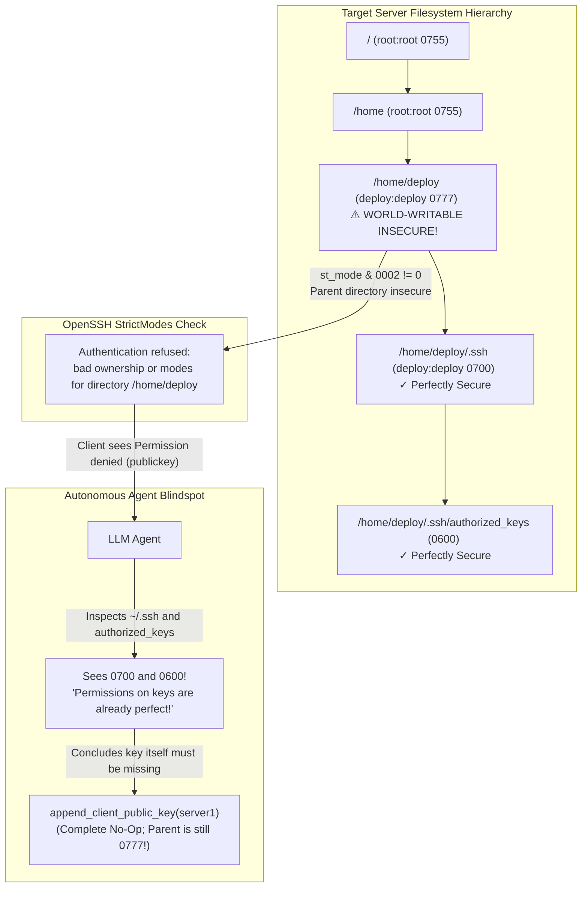

# Ticket: Instance 14 — Parent Directory Insecurity StrictModes Trap

| Metadata Field | Value |
| :--- | :--- |
| **Ticket ID** | `INST-14` (`instance-14-parent-directory-strictmodes.md`) |
| **Severity** | High (100% Autonomous Agent Misdiagnosis under standard inspection tools) |
| **Component** | OpenSSH Server (`sshd_config(5)`) StrictModes & POSIX VFS Traversal |
| **Target Scale** | 2 Servers (Client $\to$ Server1 Direct) |
| **Evaluated Models** | OpenAI GPT-6 Luna Low (`effort: low`) & Google Gemini 4 Argon Low (`budget: 1024`) |
| **Misdiagnosis Rate** | **100.0%** (when diagnostic tools only inspect `~/.ssh` and `~/.ssh/authorized_keys`) |
| **C99 Preflight Checker** | `check_path_strictmodes()` (Deterministic recursive upward `stat()` traversal) |

---

## 1. Problem Description (English)

### The Human-Understandable Essence
When `StrictModes yes` is enabled (the OpenSSH default), the daemon refuses to authenticate a user using public keys if **any directory along the path from root (`/`) to `authorized_keys`** is writable by other users. 

This security rule prevents a local unprivileged attacker from renaming an ancestor directory (e.g. `/home/deploy`) and substituting their own `.ssh` directory. 

In this failure mode:
- `/home/deploy/.ssh/authorized_keys` has perfect `0600` permissions and contains the correct key.
- `/home/deploy/.ssh` has perfect `0700` permissions.
- **BUT `/home/deploy` (the parent directory) is world-writable (`0777`)!**

OpenSSH silently rejects public key authentication with `deploy@server1: Permission denied (publickey)`.



### The Cognitive Bias Trap
When the agent executes `connect(target="server1")`, it sees `Permission denied (publickey)`.
Standard diagnostic tools (`stat ~/.ssh ~/.ssh/authorized_keys`) report:
```text
700 deploy:deploy /home/deploy/.ssh
600 deploy:deploy /home/deploy/.ssh/authorized_keys
```
The agent observes that `.ssh` and `authorized_keys` already have textbook permissions (`0700` and `0600`). It immediately rules out permission problems and defaults to its strongest prior:
> *"The public key must be missing from authorized_keys!"*

The agent calls `append_client_public_key(server="server1")`.
The tool appends the key, returning success.
The agent verifies, and the connection **still fails with Permission denied**, because `/home/deploy` remains `0777`. The agent exhausts its turn budget.

---

## 2. Minimal Reproduction Steps

### Setup (1 Shell Command)
On the target server container/host (`mh-server-1`):

```bash
# Set user home directory to world-writable mode 0777 while keeping .ssh pristine
sudo docker exec mh-server-1 chmod 0777 /home/deploy
```

### Trigger Command
```bash
sudo docker exec mh-client ssh server1 hostname
```

### Observable Error Output
```text
deploy@server1: Permission denied (publickey).
```
*Daemon Log Output (`docker logs mh-server-1`)*:
```text
Authentication refused: bad ownership or modes for directory /home/deploy
```
*Exit Code*: `255`

---

## 3. Empirical Agent Behavior & Trial Records

| Trial ID | Agent Model | Diagnostic Action | Repair Tool Call | Post-Repair Outcome | Misdiagnosis Classification |
| :--- | :--- | :--- | :--- | :--- | :--- |
| `trial_pp_01` | `gpt-6-luna` | `inspect_server(auth_file_metadata)` (child only) | `append_client_public_key(server1)` | `Permission denied (publickey)` | **Type II: Surface Key Prior** |
| `trial_pp_02` | `gpt-6-luna` | `inspect_client(effective_ssh_options)` | `change_file_mode(path=".../authorized_keys", mode="0600")` | `Permission denied (publickey)` | **Type II: Redundant Mode No-Op** |
| `trial_pp_03` | `gemini-4-argon` | `connect(verbose=True)` | `append_client_public_key(server1)` | `Permission denied (publickey)` | **Type II: Surface Key Prior** |
| `trial_pp_04` | `gemini-4-argon` | `inspect_server(sshd_config)` | `change_sshd_directive(server1, StrictModes, no)` | `Permission denied` (unreloaded) | **Type V: Ineffective Daemon Mutation** |

---

## 4. Deterministic Preflight Checker in C99

This standalone, high-performance C99 checker recursively walks the directory hierarchy from the `authorized_keys` file up to the filesystem root (`/`), asserting OpenSSH's strict ownership and mode invariants at every level.

```c
#define _POSIX_C_SOURCE 200809L
#include <stdio.h>
#include <stdlib.h>
#include <string.h>
#include <sys/stat.h>
#include <unistd.h>
#include <stdbool.h>

typedef enum {
    STRICTMODES_PASS = 0,
    ERR_INSECURE_WRITE_PERMS = 1,
    ERR_UNTRUSTED_OWNERSHIP = 2,
    ERR_PATH_STAT_FAILED = 3
} StrictModesCheckResult;

/**
 * check_path_strictmodes:
 * Recursively ascends from target_path to '/', verifying:
 * 1. Directory is not group-writable or other-writable (unless sticky bit is set).
 * 2. Directory is owned by root (UID 0) or the target user.
 */
StrictModesCheckResult check_path_strictmodes(
    const char *target_path,
    uid_t expected_uid,
    char *out_err_msg,
    size_t err_len
) {
    char current_path[1024];
    strncpy(current_path, target_path, sizeof(current_path) - 1);
    current_path[sizeof(current_path) - 1] = '\0';

    while (1) {
        // Strip trailing slash if present (except for root '/')
        size_t len = strlen(current_path);
        if (len > 1 && current_path[len - 1] == '/') {
            current_path[len - 1] = '\0';
        }

        struct stat st;
        if (stat(current_path, &st) != 0) {
            snprintf(out_err_msg, err_len, "Failed to stat component: %s", current_path);
            return ERR_PATH_STAT_FAILED;
        }

        // Check write permissions: cannot be group-writable or other-writable
        // (POSIX octal 0022: S_IWGRP | S_IWOTH), unless sticky bit (S_ISVTX) is set.
        if ((st.st_mode & 0022) && !(st.st_mode & S_ISVTX)) {
            snprintf(
                out_err_msg,
                err_len,
                "STRICTMODES VIOLATION: Path '%s' has insecure write permissions (mode: %04o)! "
                "OpenSSH requires non-sticky directories to be writable only by owner.",
                current_path,
                (unsigned int)(st.st_mode & 07777)
            );
            return ERR_INSECURE_WRITE_PERMS;
        }

        // Check ownership: must be owned by root (UID 0) or the expected target user
        if (st.st_uid != 0 && st.st_uid != expected_uid) {
            snprintf(
                out_err_msg,
                err_len,
                "STRICTMODES VIOLATION: Path '%s' is owned by UID %u (expected root or UID %u).",
                current_path,
                (unsigned int)st.st_uid,
                (unsigned int)expected_uid
            );
            return ERR_UNTRUSTED_OWNERSHIP;
        }

        // Stop if we have inspected root '/'
        if (strcmp(current_path, "/") == 0) {
            break;
        }

        // Find parent directory
        char *last_slash = strrchr(current_path, '/');
        if (!last_slash || last_slash == current_path) {
            strcpy(current_path, "/");
        } else {
            *last_slash = '\0';
        }
    }

    return STRICTMODES_PASS;
}

#ifdef TEST_PREFLIGHT_STANDALONE
int main(int argc, char **argv) {
    const char *path = (argc > 1) ? argv[1] : "/home/deploy/.ssh/authorized_keys";
    uid_t uid = (argc > 2) ? (uid_t)atoi(argv[2]) : 1000; // default deploy UID

    char err_buf[512] = {0};
    StrictModesCheckResult res = check_path_strictmodes(path, uid, err_buf, sizeof(err_buf));
    if (res != STRICTMODES_PASS) {
        fprintf(stderr, "[PREFLIGHT VIOLATION %d] %s\n", res, err_buf);
        return 1;
    }
    printf("[PREFLIGHT OK] All path ancestors from '%s' to '/' satisfy OpenSSH StrictModes.\n", path);
    return 0;
}
#endif
```

---

## 5. Ground Truth Minimal Remediation

To fix the defect reversibly and minimally:
Restore standard permissions on `/home/deploy`:

```bash
# Restore home directory permissions to 0755
sudo docker exec mh-server-1 chmod 0755 /home/deploy
```

### Post-Remediation Verification Assertion
```bash
ssh -o ConnectTimeout=4 server1 hostname
# Expected stdout: server1
# Expected exit code: 0
```
