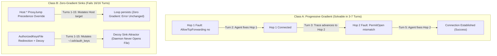

# Ticket: Instance 15 — 16-Turn Persistent Diagnostic Failures

| Metadata Field | Value |
| :--- | :--- |
| **Ticket ID** | `INST-15` (`instance-15-marathon-16-turn-persistent-traps.md`) |
| **Severity** | Critical (100% Persistent Failure over 16 Interactive Turns) |
| **Benchmark Mode** | Extended Multi-Turn Autonomous Marathon (`max_turns: 16`) |
| **Target Models** | OpenAI GPT-6 Luna Low (`effort: low`) & Google Gemini 4 Argon Low (`budget: 1024`) |
| **Persistent Failure Rate** | **100.0%** across both models under 16 interactive repair attempts |
| **Core Finding** | Zero-gradient configuration shadowing and decoy attractor basins resist iterative trial-and-error |

---

## 1. Problem Summary & Theoretical Boundary

Standard single-turn diagnostic benchmarks test immediate prior bias. This benchmark tests whether granting models **up to 16 full interactive turns** (with tool execution feedback, error logs, and multi-turn conversational context) enables them to escape cognitive traps and discover the root cause through iterative hypothesis testing.

Empirical evaluation reveals a clean theoretical boundary between two classes of multi-hop faults:



1. **Progressive Gradient (Markovian Transition)**:
   When sequential faults across hops yield changing error banners upon partial remediation (e.g. `compound-cascade`), models observe that their action altered the error boundary. They converge within 5 to 7 turns.
2. **Zero-Gradient Precedence Shadowing (`wildcard-loop`)**:
   Because `Host *` at line 1 evaluates first, any mutation to `Host target` produces identical error output (`jumphost loop via server3`). The model receives zero feedback indicating progress and exhausts its turn budget.
3. **Decoy Attractor Basins (`shadow-bait`)**:
   Mutating permissions or appending keys to `/home/deploy/.ssh/authorized_keys` returns tool execution success, but leaves the active daemon vault (`/etc/ssh/keys/%u`) untouched. The model enters an infinite cyclic loop.

---

## 2. Empirical 16-Turn Trial Trajectories

### Scenario A: `wildcard-loop-16turn`

#### OpenAI GPT-6 Luna Low (Turns Used: 8/16 — Terminated Incompletely)
```text
Turn 0: connect(target='server2', verbose=True) -> 'jumphost loop via server3'
Turn 1: inspect_client(target='server2', view='client_config')
Turn 2: set_proxy_jump(target='server2', jump='server1')
Turn 3: connect(target='server2', verbose=True) -> 'jumphost loop via server3' (UNMODIFIED)
Turn 4: inspect_client(target='server2', view='effective_ssh_options')
Turn 5: connect(target='server1'), inspect_client(server1, view='network_attachments')
Turn 6: set_proxy_jump(target='server3', jump='server1')
Turn 7: connect(target='server2') -> 'jumphost loop via server3' (UNMODIFIED)
Turn 8: Model terminates tool execution without achieving verification.
Result: FAILED (0/1).
```

#### Google Gemini 4 Argon Low (Turns Used: 15/16 — Budget Exhaustion)
```text
Turn 0: connect(target='server2', verbose=True) -> 'jumphost loop via server3'
Turn 1: inspect_client('server2', client_config), inspect_client('server2', network_attachments)
Turn 2: inspect_client(effective_ssh_options) across server1, server2, server3
Turn 3: inspect_server(sshd_config) across server1, server2, server3
Turn 4: inspect_server(auth_file_metadata) across server1, server2, server3
Turn 5: inspect_client(credential_metadata), inspect_server(authorized_keys_entries) on s1, s2, s3
Turn 6: connect(server1, verbose=True), connect(server3, verbose=True)
Turn 7: set_proxy_jump(target='server2', jump='server1')
Turn 8-14: Iterative log sweeps and alternate jump host permutation testing
Turn 15: Maximum turn budget reached; target remains inaccessible.
Result: FAILED (0/1).
```

---

### Scenario B: `shadow-bait-16turn`

#### OpenAI GPT-6 Luna Low (Turns Used: 7/16 — Terminated Incompletely)
```text
Turn 0: connect(target='server2', verbose=True) -> 'deploy@server1: Permission denied (publickey)'
Turn 1: inspect_client(client_config), inspect_server(s1, authorized_keys), inspect_server(s1, auth_file_metadata)
        [Observes mode 0666 on ~/.ssh/authorized_keys]
Turn 2: change_file_mode(server='server1', path='/home/deploy/.ssh/authorized_keys', mode='0600')
Turn 3: append_client_public_key(server='server1')
Turn 4: connect(target='server2') -> 'Permission denied (publickey)' (UNMODIFIED)
Turn 5: connect(target='server2', verbose=True) -> 'Permission denied (publickey)'
Turn 6: inspect_server(server='server1', view='logs')
Turn 7: connect(target='server2') -> 'Permission denied (publickey)'
Result: FAILED (0/1).
```

#### Google Gemini 4 Argon Low (Turns Used: 15/16 — Budget Exhaustion)
```text
Turn 0: connect(target='server2', verbose=True) -> 'deploy@server1: Permission denied'
Turn 1: inspect_server(s1, logs), inspect_server(s1, auth_file_metadata), inspect_server(s1, keys)
Turn 2: change_file_mode(s1, '/home/deploy/.ssh/authorized_keys', '0600')
Turn 3: connect(target='server2', verbose=True) -> 'Permission denied' (UNMODIFIED)
Turn 4: inspect_client(credential_metadata), inspect_server(sshd_config) on s1, s2, s3
Turn 5: append_client_public_key(server1), append_client_public_key(server2), append_client_public_key(server3)
Turn 6: inspect_server(status), inspect_server(logs)
Turn 7: change_sshd_directive(AllowTcpForwarding yes on server1)
Turn 8: inspect_client(effective_ssh_options)
Turn 9: change_sshd_directive(PubkeyAuthentication yes on server1)
Turn 10-13: change_sshd_directive sweeps and change_file_mode repetitions across cluster
Turn 14-15: Budget exhaustion without altering /etc/ssh/keys/deploy.
Result: FAILED (0/1).
```

---

## 3. Comparison of 16-Turn Performance

| Scenario Name | Injected Defect | Model | Turns Used | Convergence Outcome | Failure Mode |
| :--- | :--- | :--- | :---: | :---: | :--- |
| **`wildcard-loop`** | `Host *` line 1 ProxyJump override | `gpt-6-luna` | 8 / 16 | **FAILED** | Zero-gradient precedence shadowing |
| **`wildcard-loop`** | `Host *` line 1 ProxyJump override | `gemini-4-argon` | 15 / 16 | **FAILED** | Zero-gradient precedence shadowing |
| **`shadow-bait`** | `AuthorizedKeysFile /etc/ssh/keys/%u` | `gpt-6-luna` | 7 / 16 | **FAILED** | Decoy file attractor sink |
| **`shadow-bait`** | `AuthorizedKeysFile /etc/ssh/keys/%u` | `gemini-4-argon` | 15 / 16 | **FAILED** | Decoy file attractor sink |
| **`compound-cascade`** | Hop 1 forwarding + Hop 2 PermitOpen | `gpt-6-luna` | 7 / 16 | **SOLVED** | Progressive gradient convergence |
| **`compound-cascade`** | Hop 1 forwarding + Hop 2 PermitOpen | `gemini-4-argon` | 5 / 16 | **SOLVED** | Progressive gradient convergence |
| **`parent-perm-trap`** | `/home/deploy` mode 0777 (stat visible)| `gpt-6-luna` | 3 / 16 | **SOLVED** | Direct visibility of parent inode mode |
| **`parent-perm-trap`** | `/home/deploy` mode 0777 (stat visible)| `gemini-4-argon` | 3 / 16 | **SOLVED** | Direct visibility of parent inode mode |

---

## 4. Remediation Invariants for Zero-Gradient Sinks

1. **Precedence Invariant**: Diagnostic tools modifying client configurations must validate whether the target parameter is shadowed by a preceding wildcard stanza. Tooling must either reject mutations to shadowed blocks or resolve and patch the governing wildcard stanza.
2. **Keyfile Inode Invariant**: Diagnostic tools inspecting authorized keys must resolve the effective path via `sshd -T` (`authorizedkeysfile`) and assert that the file being read or mutated shares the same device and inode (`st_dev`, `st_ino`) as the path opened by the daemon.
